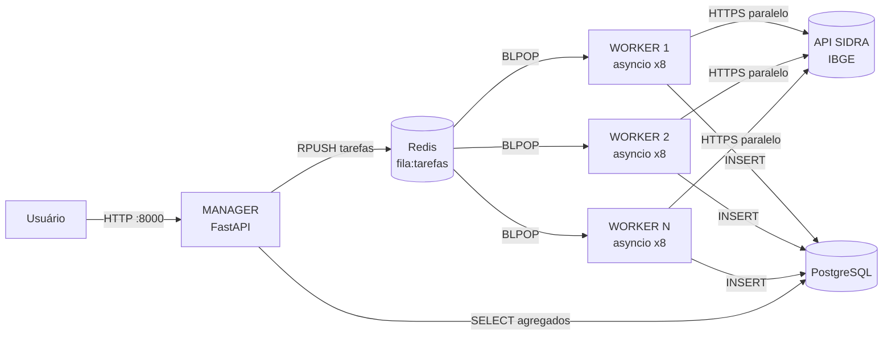
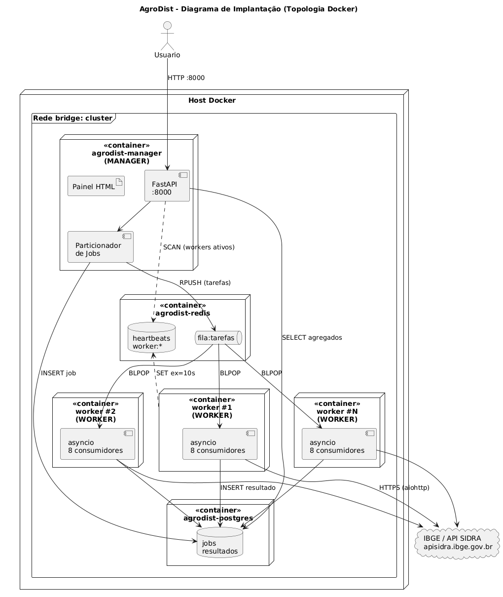
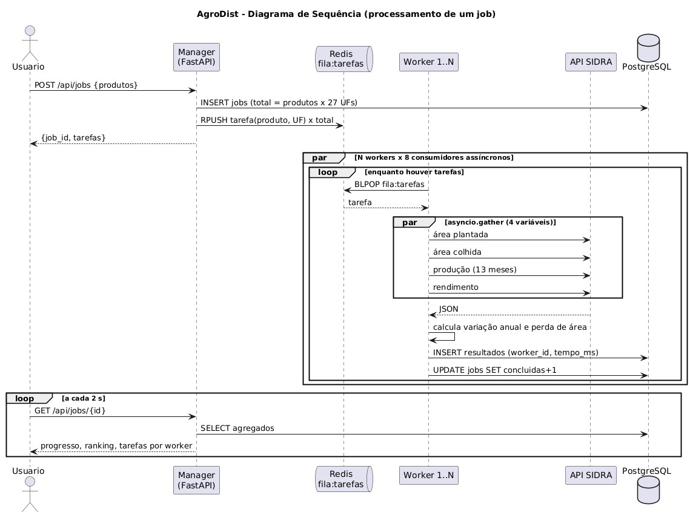
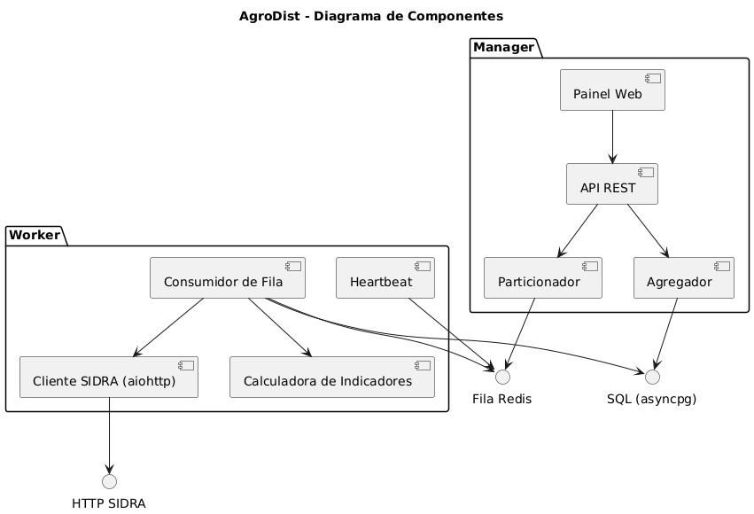

# AgroDist: Monitor Distribuído de Safras Agrícolas

Projeto final da disciplina **Desenvolvimento de Sistemas Distribuídos**, com o professor Vitório Neto.

**Equipe:** Alan, Angelo, João Paulo, João Victor, Lucas e Vitor.

O AgroDist consome dados do **LSPA (Levantamento Sistemático da Produção Agrícola)** pela **API SIDRA do IBGE** (tabela 6588). O processamento é distribuído entre um nó **Manager** (coordenador) e vários nós **Workers**, que trabalham em paralelo. O resultado é um panorama da safra brasileira por cultura e por estado.

## Tema: Agronegócio

O agronegócio responde por cerca de um quarto do PIB brasileiro. O LSPA é a principal estimativa oficial das safras e é atualizado todo mês. Para cada combinação de **cultura × UF**, o sistema calcula:

| Indicador | Para que serve |
|---|---|
| Área plantada e colhida (ha) | Expansão da fronteira agrícola e uso da terra |
| Produção (t) | Ranking produtivo entre estados e culturas |
| Rendimento médio (kg/ha) | Produtividade: produzir mais sem desmatar (ligação com ESG) |
| Variação da produção em 12 meses (%) | Tendência da safra e impacto de clima e preços |
| Perda de área (plantada − colhida) | Indício de quebra de safra por seca, geada ou pragas |

## Arquitetura

O sistema segue o padrão **Manager/Worker** com **fila de mensagens**:



- **Manager** (`manager/`): recebe o pedido, **particiona** o trabalho em tarefas (1 tarefa = 1 cultura × 1 UF; 4 culturas × 27 UFs = 108 tarefas, processadas em cerca de 70 s com 3 workers), publica as tarefas na fila e agrega os resultados para o painel.
- **Workers** (`worker/`): contêineres idênticos e sem estado, que consomem a fila de forma concorrente. Podem ser escalados horizontalmente.
- **Redis**: fila de tarefas (`BLPOP` garante que cada tarefa vá para um único worker) e heartbeat dos workers ativos.
- **PostgreSQL**: armazena os jobs e os resultados, incluindo qual worker processou cada tarefa e o tempo gasto.

### Paralelismo em três níveis

1. **Entre nós**: N contêineres worker consomem a mesma fila (`docker compose --scale worker=N`).
2. **Dentro de cada worker**: `WORKER_CONCURRENCY` corrotinas `asyncio` consomem tarefas ao mesmo tempo (padrão: 8).
3. **Dentro de cada tarefa**: as 4 variáveis do SIDRA são buscadas simultaneamente com `asyncio.gather`.

Também foram implementados mecanismos de controle e tolerância a falhas: um **semáforo** limita as conexões simultâneas de cada worker ao SIDRA (`SIDRA_MAX_CONEXOES`, padrão 4), porque a API do IBGE derruba conexões quando recebe rajadas grandes; retentativa com backoff exponencial nas chamadas ao SIDRA; *heartbeat* com expiração para detectar workers inativos, e `healthcheck`/`depends_on` no Compose.

### Diagramas UML

Os arquivos PlantUML ficam em [`docs/uml/`](docs/uml):

- [`implantacao.puml`](docs/uml/implantacao.puml): topologia Docker (nós Manager, Workers, Redis e Postgres).
- [`componentes.puml`](docs/uml/componentes.puml): componentes internos de cada nó.
- [`sequencia.puml`](docs/uml/sequencia.puml): fluxo completo de um job.

Para gerar as imagens, use a extensão PlantUML do VS Code ou cole o conteúdo em https://www.plantuml.com/plantuml.

#### Implantação (topologia Docker)


#### Sequência


#### Componentes


### Tecnologias

Python 3.12 · FastAPI · asyncio · aiohttp · asyncpg · Redis 7 · PostgreSQL 16 · Docker Compose

## POP: Passo a passo para subir o projeto

### Pré-requisitos
- [Docker Desktop](https://www.docker.com/products/docker-desktop/) instalado e **em execução** (no Windows, com WSL 2 habilitado)
- Git
- Acesso à internet (a API do SIDRA é pública e não exige chave)

### 1. Clonar o repositório
```bash
git clone https://github.com/joaopsilva12/projeto_sistemas_distribuidos.git
cd projeto_sistemas_distribuidos
```

### 2. (Opcional) Configurar as variáveis de ambiente
```bash
cp .env.example .env
```
Sem o arquivo `.env`, o sistema usa valores padrão.

### 3. Subir o cluster (1 Manager + 3 Workers)
```bash
docker compose up --build -d
```

### 4. Conferir os nós em execução
```bash
docker compose ps
```
Devem aparecer `agrodist-manager`, `agrodist-worker-1`, `-2`, `-3`, `agrodist-redis` e `agrodist-postgres`.

### 5. Usar o sistema
Abra **http://localhost:8000** (se não abrir, use **http://127.0.0.1:8000**), escolha as culturas e clique em **Distribuir tarefas**. O painel mostra em tempo real a fila, os workers ativos, o progresso e o que cada worker processou.

A documentação interativa da API fica em **http://localhost:8000/docs**.

### 6. Escalar os workers (demonstração da distribuição)
```bash
docker compose up -d --scale worker=6
```

### 7. Acompanhar os logs dos workers
```bash
docker compose logs -f worker
```

### 8. Encerrar
```bash
docker compose down        # mantém os dados
docker compose down -v     # apaga também o banco
```

## Endpoints

| Método | Rota | Descrição |
|---|---|---|
| GET | `/` | Painel web |
| GET | `/api/catalogo` | Culturas e UFs disponíveis |
| POST | `/api/jobs` | Cria um job. Corpo: `{"produtos": ["39443"], "ufs": ["51"]}` (sem `ufs`, usa todas) |
| GET | `/api/jobs` | Lista os últimos jobs |
| GET | `/api/jobs/{id}` | Progresso, ranking, distribuição por worker e resultados |
| GET | `/api/cluster` | Tamanho da fila e workers ativos |

## Estrutura

```
├── docker-compose.yml     # topologia: manager, worker (x3), redis, postgres
├── manager/               # nó coordenador (FastAPI + painel)
├── worker/                # nó de processamento (asyncio + aiohttp)
├── db/init.sql            # esquema do banco
└── docs/uml/              # diagramas UML
```

## Fonte dos dados
IBGE, Levantamento Sistemático da Produção Agrícola (LSPA), tabela 6588, via [API SIDRA](https://apisidra.ibge.gov.br/).
